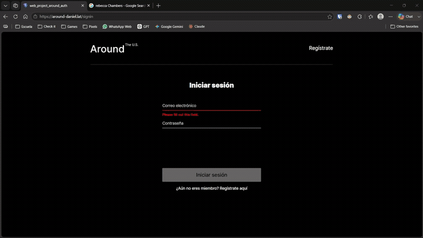

# Around The U.S. — Aplicación completa

Aplicación web donde cada usuario tiene un perfil y publica tarjetas con lugares.
Este repositorio reúne las dos mitades del proyecto: el cliente en React y la API
en Node.js, que ahora comparten un mismo servidor de autenticación.

```
backend/    API REST con Express, MongoDB y autenticación JWT
frontend/   Cliente en React con Vite
```

## La aplicación está en línea

Puedes usarla ahora mismo, sin instalar nada:

### → https://around-daniel.lat

La API responde en https://api.around-daniel.lat

En la página ya hay cuentas de prueba listas. Todas comparten la
contraseña `residentevil`:

```
ada.wong@example.com
leon.kennedy@example.com
claire.redfield@example.com
chris.redfield@example.com
jill.valentine@example.com
albert.wesker@example.com
```

## La aplicación en uso


En un teléfono: el diseño se adapta a una sola columna y desde el botón de añadir
se crea una tarjeta nueva, que aparece al principio de la galería sin recargar la
página.



En escritorio, el recorrido completo de una cuenta nueva: intentar entrar con un
correo que no existe devuelve un error, se registra ese mismo correo, se inicia
sesión con él, y ya dentro se editan el nombre, la descripción y el avatar.

## Funcionalidades

- Registro e inicio de sesión con correo electrónico y contraseña
- Contraseñas almacenadas como hash; la API nunca las devuelve
- Autorización mediante JWT con caducidad de siete días
- Todas las rutas de la API protegidas salvo `/signin` y `/signup`
- Perfil editable: nombre, descripción y avatar
- Tarjetas: crear, eliminar y dar o quitar "me gusta"
- Cada usuario solo puede borrar sus propias tarjetas y editar su propio perfil

## Tecnologías

**Backend:** Node.js, Express, MongoDB con Mongoose, bcryptjs para el hash de
contraseñas, jsonwebtoken para los JWT, celebrate y validator para validar la
entrada, y winston para los registros.

**Frontend:** React con hooks y contexto, React Router para el enrutamiento del
lado del cliente, Vite como empaquetador y CSS con metodología BEM.

**Infraestructura:** servidor Ubuntu en Vultr, MongoDB Atlas como base de datos,
PM2 como gestor de procesos, nginx como servidor web y proxy inverso, y
certificados de Let's Encrypt renovados automáticamente con certbot.

## Endpoints

| Método | Ruta                   | Acceso    | Descripción                     |
| ------ | ---------------------- | --------- | ------------------------------- |
| POST   | `/signup`              | Público   | Registrar un usuario            |
| POST   | `/signin`              | Público   | Iniciar sesión y recibir el JWT |
| GET    | `/users/me`            | Protegido | Datos del usuario en sesión     |
| GET    | `/users`               | Protegido | Lista de usuarios               |
| GET    | `/users/:userId`       | Protegido | Un usuario por su id            |
| PATCH  | `/users/me`            | Protegido | Actualizar nombre y descripción |
| PATCH  | `/users/me/avatar`     | Protegido | Actualizar el avatar            |
| GET    | `/cards`               | Protegido | Lista de tarjetas               |
| POST   | `/cards`               | Protegido | Crear una tarjeta               |
| DELETE | `/cards/:cardId`       | Protegido | Borrar una tarjeta propia       |
| PUT    | `/cards/:cardId/likes` | Protegido | Dar "me gusta"                  |
| DELETE | `/cards/:cardId/likes` | Protegido | Quitar "me gusta"               |

Las rutas protegidas esperan el encabezado `Authorization: Bearer {token}`.

## Códigos de error

| Código | Cuándo                                               |
| ------ | ---------------------------------------------------- |
| 400    | Datos inválidos o identificador mal formado          |
| 401    | Credenciales incorrectas, o token ausente o inválido |
| 403    | Intento de borrar una tarjeta ajena                  |
| 404    | El recurso o la dirección no existen                 |
| 409    | El correo ya está registrado                         |
| 500    | Error inesperado del servidor                        |

Todas las respuestas de error contienen únicamente el campo `message`.

## Seguridad

Las contraseñas nunca se guardan en claro: se almacenan como hash de bcrypt con
diez rondas y una sal distinta por usuario, de modo que dos contraseñas iguales
producen hashes diferentes. El campo está marcado con `select: false` en el
esquema, así que ni siquiera una consulta descuidada puede devolverlo.

La autorización se resuelve con un JWT firmado con `JWT_SECRET`, que vive
únicamente en el archivo `.env` del servidor y nunca se sube al repositorio. El
middleware `auth` protege todas las rutas salvo el registro y el inicio de
sesión, y la propiedad de cada recurso se comprueba de nuevo en el controlador:
el token dice quién eres, pero es el servidor el que decide qué puedes borrar.

Toda la entrada pasa por celebrate y Joi antes de llegar a los controladores, y
los mensajes de error se normalizan en un único middleware para no filtrar
detalles internos: cualquier fallo no previsto se responde como un 500 genérico.

El tráfico viaja cifrado con certificados de Let's Encrypt y nginx redirige HTTP
a HTTPS. El acceso a la base de datos está restringido por lista de direcciones
IP en Atlas, además de por credenciales.

## Registros

El backend escribe dos archivos con winston y express-winston:

```
backend/request.log    todas las peticiones recibidas
backend/error.log      solo los errores
```

## Despliegue

El backend corre bajo PM2 en un servidor Ubuntu, lo que lo reinicia solo si el
proceso muere y lo levanta de nuevo tras un reinicio de la máquina. El frontend
se compila en local y se sirve como archivos estáticos desde nginx, que además
actúa como proxy inverso hacia el puerto 3000 para el subdominio de la API.

La configuración de nginx incluye `try_files $uri $uri/ /index.html` para que las
rutas del lado del cliente funcionen al recargar la página: sin esa línea,
entrar directamente a `/signin` devolvería un 404.

## Autor

Daniel Pérez Cruz
